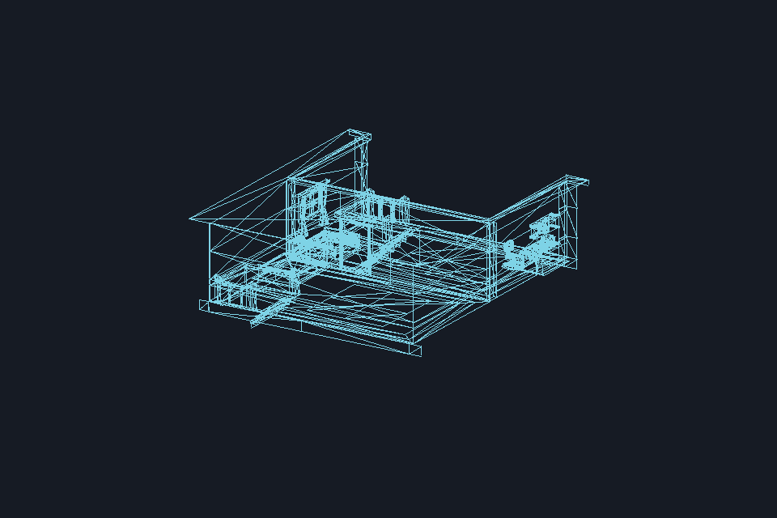
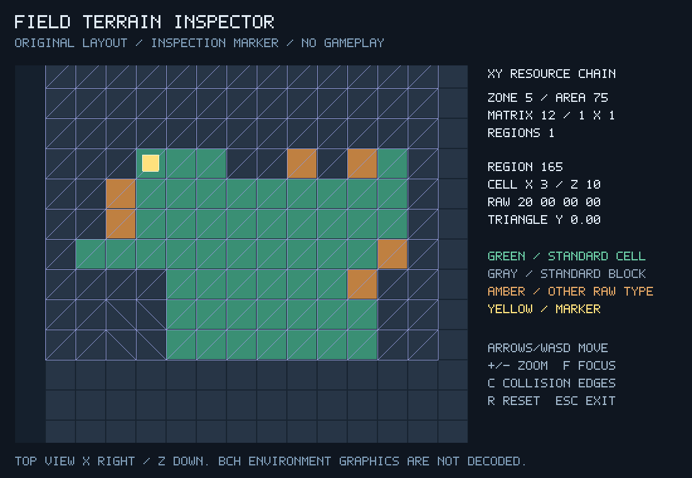
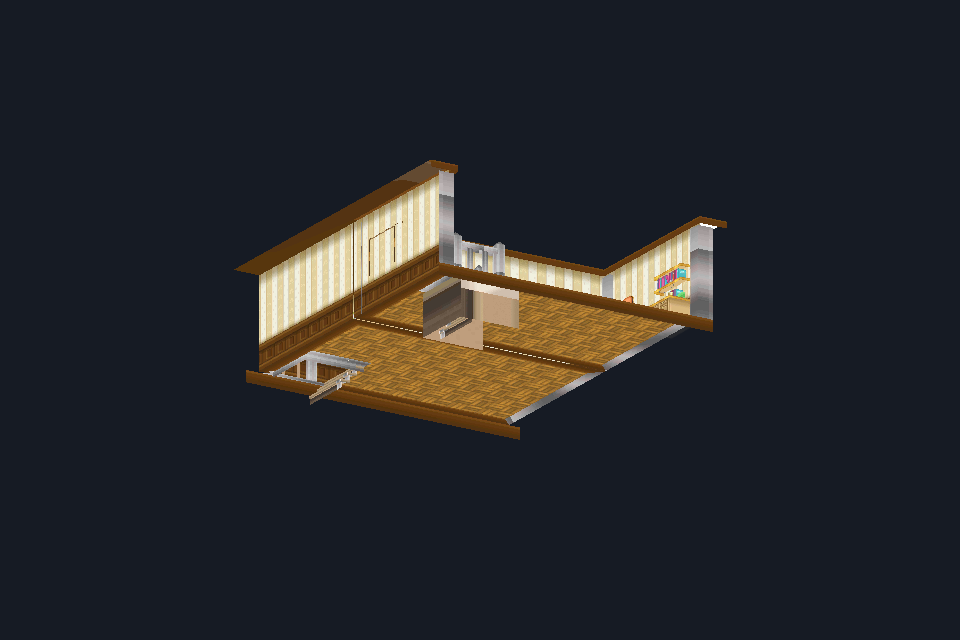
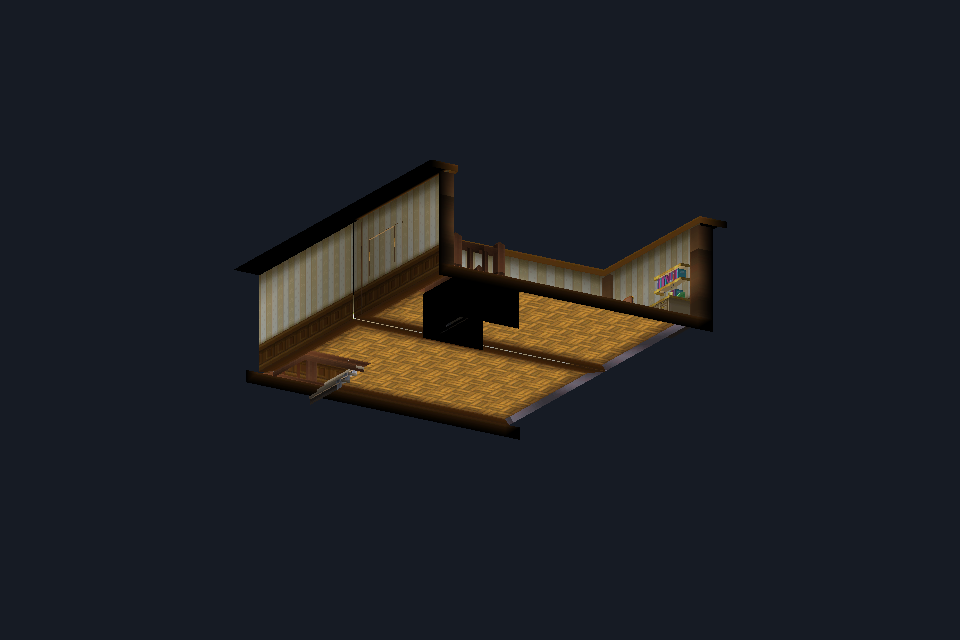
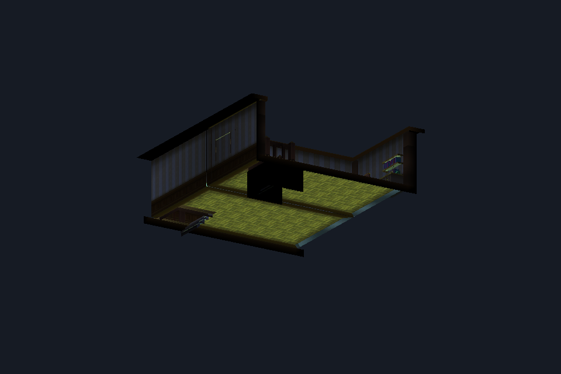
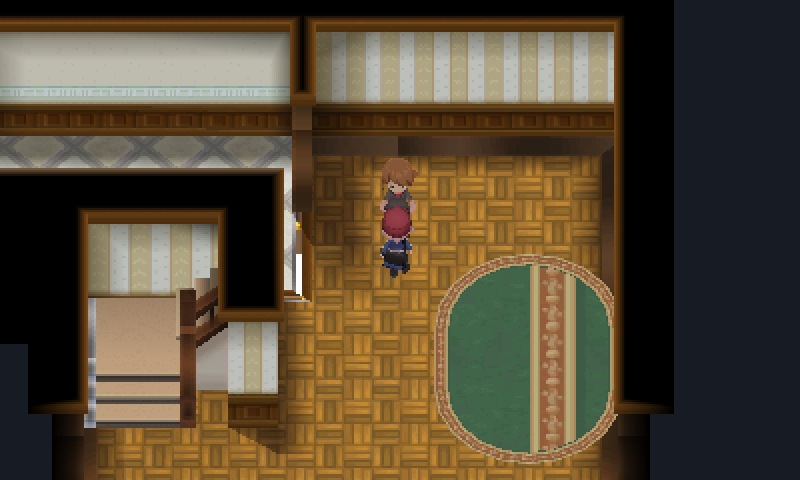

<div align="center">

# Pokémon X decompilation

**From original 3DS data to native C, one verified subsystem at a time.**

[](https://github.com/chanadinh/pokemon-x-decomp/actions/workflows/tests.yml)
[](reconstructed/README.md)
[](ROADMAP.md)

[Get started](#get-started) · [See it running](#see-it-running) · [Explore the source](#rebuilding-the-rules) · [Next milestone](#the-road-to-a-playable-slice)

<a href="docs/native-bch.md"></a>

*An original field model, decoded and drawn by the native viewer: 12 meshes, 2,356 vertices, 4,992 indices.*

</div>

This project is rebuilding Pokémon X's game logic and asset pipeline in portable C.
The work now reaches from Pokémon construction and stat calculations to decoding
original textures, inspecting field layouts, and drawing models in native SDL2
applications. Every milestone comes with tests, recorded evidence, and an explicit
account of what remains unknown.

**The destination is a native PC game. Today, this is a research project with
working asset viewers and eight connected game-logic milestones; it is not yet a
playable port.** The wireframe above uses an explicit triangle-list interpretation;
the original field's primitive setup and materials still need verification.

| Game logic | Native field model | Area textures | Preserved checkpoints |
| :---: | :---: | :---: | :---: |
| **8** connected C milestones | **12** meshes and **12** material bindings checked independently | **19** images, **100,608** pixels matched | **539** reconstruction file hashes |

## See it running

These are actual captures from this workspace's native applications. The images
show inspected original assets and resource data, with the limits described below.

<table>
  <tr>
    <td width="50%" valign="top">
      <a href="docs/native-materials.md"></a>
      <p><strong>Textures become geometry.</strong><br>
      Six CGFX material bindings connect UVs, vertex colors and textures in an unlit software preview. Orbit and zoom around 767 vertices and 936 triangles.</p>
      <p><a href="docs/native-materials.md">Explore the material renderer →</a></p>
    </td>
    <td width="50%" valign="top">
      <a href="docs/native-field.md"></a>
      <p><strong>A field becomes inspectable.</strong><br>
      Follow zone 5 → matrix 12 → region 165. Inspect terrain words, collision edges and an inspection marker with a deliberately restricted movement policy.</p>
      <p><a href="docs/native-field.md">Follow the field resource chain →</a></p>
    </td>
  </tr>
</table>

<p align="center">
  <a href="docs/native-bch.md#native-textured-preview"></a>
</p>

**The field gets its textures.** The same room now draws with area 75's
textures. Each of its twelve materials picks its texture through its own first
combiner stage, and an independent check re-derives all 432 register values the
preview reads. With `--combiners` the viewer runs all six combiner stages and the
model's baked vertex colors, checked against an independent oracle on 116,000
evaluations. [See the textured field preview →](docs/native-bch.md#native-textured-preview)

<table>
  <tr>
    <td width="50%"><a href="docs/native-bch.md#directional-fragment-lighting"></a></td>
    <td width="50%"><a href="docs/native-bch.md#directional-fragment-lighting"></a></td>
  </tr>
</table>

**The room is lit by its own lights.** The field's sun and night lights live in a
separate scene environment, which the viewer now decodes and applies. Two
conventions come from the original executable: the sign of the light direction,
and how light and material colors combine. The lighting matches an independent
oracle on 20,970 evaluations.
[See day and night lighting →](docs/native-bch.md#directional-fragment-lighting)
With `--walk`, the game's player-character model walks the lit room on its terrain
grid and collision floor; all 52 walkable cells line up with the model's floor.
The player is skinned and animated from the game's own motion pack. With
`--zone 5` the scene comes entirely from game data: the player walks the house in
real time, takes the stairs between floors and talks to the NPC downstairs
(dialogue itself is not executed yet).

<p align="center"><a href="docs/native-bch.md#playing-the-house"></a></p>

[What remains before the first playable →](docs/PLAYABLE_SLICE.md#what-remains-before-the-first-playable)

The previews do not reproduce the game's complete shaders: the vertex shader,
point lights, fog and projected textures are still missing.
The terrain image records an earlier milestone; its footer predates the separate
BCH wireframe viewer shown above. The marker is an inspection tool, not a player
character. [Capture provenance and validation](docs/images/README.md) identify the
source of each image.

The latest native checkpoint textures the selected BCH field model. Every bound
texture matches an image already verified pixel by pixel, and 99.85% of the
covered pixels in a software capture are exact texels. Earlier checkpoints match
every position, UV and rebased index, and follow the zone's area ID into the
texture archive and its BCH section consumer in the original executable.
[Read the geometry evidence](native/reproduction/bch-native/README.txt) or
[inspect the texture comparison](native/reproduction/bch-textures/README.txt).

## Get started

### Run the reconstructed logic

You need Git, Make, a C11 compiler and Python 3. On Linux or WSL:

```sh
git clone https://github.com/chanadinh/pokemon-x-decomp.git
cd pokemon-x-decomp
make -C reconstructed test
python3 -m unittest discover -s tests -v
```

These tests use synthetic data and need no game files or Ghidra. Optional
extraction integration tests skip when PowerShell or 3dstool is unavailable.

### Open a native demo

With SDL2 development files and pkg-config installed:

```sh
make -C native all
native/build/pokemon_asset_viewer --demo
native/build/pokemon_model_viewer --demo --textured
native/build/pokemon_field_viewer --demo
```

All three demos run without game files. The texture viewer provides pan/zoom and
image export; the model viewer provides orbit/zoom and frame capture; the field
viewer provides terrain and collision inspection. See the
[build instructions and controls](native/README.md).

### Inspect your local game assets

Replace `/path/to/romfs` with your locally extracted RomFS directory:

```sh
# Original textured CGFX sample
native/build/pokemon_model_viewer --romfs /path/to/romfs \
  --archive a/1/0/2 --entry 0 --textured

# BCH field wireframe pictured above; topology interpretation is explicit
native/build/pokemon_model_viewer --romfs /path/to/romfs \
  --archive a/0/4/1 --entry 165 --section 1 --triangle-list

# The same field with its area textures (unlit, first combiner stage only)
native/build/pokemon_model_viewer --romfs /path/to/romfs \
  --archive a/0/4/1 --entry 165 --section 1 --triangle-list --textured \
  --texture-archive a/0/1/3 --texture-entry 75 --texture-section 11
# Add --combiners for all six combiner stages with baked vertex colors, then
# --environment-archive a/0/0/3 --environment-entry 137 --environment-section 0
# for directional lighting (--lighting day|night)

# List the selected area's 19 BCH textures
native/build/pokemon_asset_viewer --romfs /path/to/romfs \
  --archive a/0/1/3 --entry 75 --section 11 --list-textures

# Terrain and collision inspector
native/build/pokemon_field_viewer --romfs /path/to/romfs --zone 5
```

## Rebuilding the rules

The visual tools sit alongside eight connected C reconstruction milestones.
An integration fixture connects wild-battle request preparation to Pokémon
construction, payload storage, state refresh and stat calculations.

| Subsystem | Reconstructed behavior |
| --- | --- |
| [Wild-battle script wrapper](reconstructed/call_wild_battle/README.md) | Argument handling and helper call order |
| [Wild-battle setup](reconstructed/wild_battle_setup/README.md) | Buffer initialization, packed records and context updates |
| [Battle task](reconstructed/battle_task/README.md) | Task creation, request consumption and state handling |
| [Encounter builder](reconstructed/encounter_builder/README.md) | Creation parameters, population loop and configuration selection |
| [Pokémon constructor](reconstructed/pokemon_constructor/README.md) | Parameter normalization, allocation, manager setup and XOR transform |
| [Pokémon data](reconstructed/pokemon_data/README.md) | Population, 26 field setters, checksum and storage codec |
| [Pokémon state](reconstructed/pokemon_state/README.md) | Initialization, HP/PP refresh and 13 field accessors |
| [Pokémon stats](reconstructed/pokemon_stats/README.md) | HP/stat updates, nature adjustment and growth-to-level lookup |

Personal/growth resources, learnset access, move insertion, name construction and
maximum-PP services still use synthetic resources or callbacks where their
dependencies remain unresolved. These are analyst-authored reconstructions, not
recovered original source or builds that match the original machine code.

<details>
<summary><strong>What the validation establishes</strong></summary>

- The latest native milestone passes **17 C suites, 43 inspector tests and 57 viewer runtime tests**, plus AddressSanitizer, UndefinedBehaviorSanitizer and LeakSanitizer checks on the lighting and combiner evaluators, BCH readers and viewer.
- The field's **16 environment lights, 12 light sets and 7,068 normal components** match an independent parser. The lighting evaluator matches an independent float32 oracle of the pinned emulator behavior on **20,970** evaluations, and **44** original-code words back its sign and color conventions.
- The six-stage combiner evaluator matches an independent oracle of the pinned emulator behavior on **116,000** evaluations, and **2,356** decoded vertex colors match bit for bit.
- The selected field's **12 material bindings and 432 register observations** match an independent parser that follows pinned CTRMap register layouts.
- The selected area's **100,608 texture pixels** match an independent decoder and separately implemented alpha/tile reconstruction.
- The selected field's **positions, UVs and indices** match an independent geometry reference at the native renderer's documented precision.
- The area-consumer trace checks **1,348 instructions** against original executable bytes across thirteen functions.
- All **539 earlier reconstruction checkpoint files** retain their recorded hashes.

These results validate specific boundaries. They do not establish running-game
behavior or visual equivalence. The analysis baseline's 133 CRO modules, 44,279
candidate functions and 230 exported pseudocode functions are inventory counts,
not a completion percentage.

</details>

## The road to a playable slice

The next step is to connect these tested pieces into a game scene:

- **Complete the field renderer:** add the vertex shader's outputs, point lights and the day/night selection, fog and projected textures; establish original primitive state, culling and camera; integrate the scene.
- **Connect the player:** reconstruct entry, movement, collision and interaction behavior.
- **Finish the gameplay loop:** replace remaining resource stand-ins, connect battle and return-to-field behavior, and implement save/load.
- **Compare against the original:** capture a repeatable reference scenario and check behavior at each boundary.

The [roadmap](ROADMAP.md) tracks dependencies. The
[first playable slice](docs/PLAYABLE_SLICE.md) defines acceptance criteria.

Contributions in C, ARM reverse engineering, tooling, documentation and testing
are welcome. Start with [CONTRIBUTING.md](CONTRIBUTING.md),
[report a reproducible bug](https://github.com/chanadinh/pokemon-x-decomp/issues/new?template=bug_report.yml),
or [propose a research task](https://github.com/chanadinh/pokemon-x-decomp/issues/new?template=research_task.yml).
Star the repository to follow its progress, or use **Watch → Custom → Releases**
for release notifications.

## Project notebook

[Native viewers](native/README.md) · [Source milestones](reconstructed/README.md) ·
[Analysis workflow](docs/ANALYSIS_WORKSPACE.md) · [Tool versions](tools/versions.json) ·
[Screenshot provenance](docs/images/README.md)

ROMs, executables, extracted model/texture payloads, generated analysis and saved
Ghidra projects remain local and excluded from Git. Selected native-viewer
screenshots are included for documentation. Pokémon is owned by its respective
rights holders; this project is unofficial and unaffiliated. No project license
has been declared yet.
