# Static BCH field model inspection

The selected field's BCH now has bounded Python and native C geometry decoders.
The native model viewer displays an explicit triangle-list wireframe; the Python
tool also offers an optional OBJ export. The separate SDL field viewer still
displays terrain and collision. No game assets are included in the repository.

```sh
python3 native/tools/inspect_bch_model.py --file selected.gr --gr-section 1
python3 native/tools/inspect_bch_model.py --file field165.bch \
  --texture-bch area75-world-textures.bch --triangle-list-obj new-model.obj
```

Both commands print metadata JSON. Offsets are relative to the selected BCH,
including when it came from a GR section. `--model` selects a resource index
(default zero). The optional OBJ exclusively creates a new file, includes all
accepted meshes with UV0, and uses numeric object names to keep stored resource
strings out of OBJ syntax. It does not apply visibility, materials or lighting.

## Checked sample and comparison

Zone 5 selects matrix 12/region 165 and area 75 in the existing field evidence.
The region's GR section 1 contains model `t01r0202_00_00`, with twelve meshes,
2,356 stored vertices and 4,992 raw indices. Vertices are read in buffer order
through the largest referenced index; this count is not a count of unique
positions. Repeated positions and indices are retained.

An independent, separately authored reference relocates an owned copy before
decoding. Its positions, UV0 and indices match the production resolver on all
twelve meshes, as do bounds and strides. Canonical hashes use little-endian
float64 triples/pairs and uint32 indices. Arithmetic uses Python binary64 after
reading the stored float32 values. This checks parsing against another
implementation; it does not establish original shader arithmetic or a running
game comparison. Reproduction scripts, input hashes and metadata are in
[`native/reproduction/bch-model/`](../native/reproduction/bch-model/README.txt).

## Accepted format and bounds

The decoder accepts BCH compatibility 7/7 with nonoverlapping section bounds
checked by the existing resource inspector. It keeps input bytes unchanged.
Relocations are indexed by source field, with duplicate/overlapping sources,
unsupported tags and out-of-section offsets rejected. Every dereferenced model,
material, string, command and raw-buffer pointer must carry the expected
relocation. A zero field without relocation can be null; a relocated zero
offset can refer to the first byte of a section.

The supported model has an identity transform, zero model flags, no skeleton
or submesh culling, normal unskinned meshes, and valid node/material references.
Material records provide all three nullable texture-unit names and enable bits.
Parameter records, layer ranges, metadata and shader code are not executed.
Only their consumed pointers/extents are checked; this is not full BCH validation.

PICA packets have bounded lengths, register numbers, consecutive writes and
eight-byte packet padding. Register masks affect bytes, and unwritten bits
remain unknown. Complete float32 vertex uniforms 6–8 supply position offsets
and attribute scales. Float24 uniform uploads and partial uniform writes reject.
Raw buffer addresses require a complete command write and the corresponding
vertex or 8/16-bit index relocation.

Geometry uses one interleaved buffer with checked attribute permutations,
strides and naturally aligned i8/u8/i16/f32 values. Position must have three
stored components and UV0 two. Other ordinary attributes are bounded and checked
for finite values but not exported. Fixed position/UV0, skinning attributes,
additional vertex buffers and ambiguous alignment reject. Other fixed attributes
are only identified; their float24 values are not decoded or used by the export.
All decoded numeric components must be finite and at most `1e12` in magnitude.

Budgets are 64 MiB per input, 1,024 meshes/materials/nodes, 262,144 vertices,
786,432 indices, 262,144 aggregate command words and relocation entries,
65,536 words per command stream, and 1,024 bytes per resource name. Indices and
vertex extents are checked inside raw data. Unsupported inputs fail with an error.

## Topology boundary

The selected submesh streams write primitive register `0x25e` with parameter
zero and byte mask 8, after their draw command. Those writes do not establish
bits 8–9, which encode the primitive mode. The inspector reports the encoded
parameter and masks; it does not supply invented inherited GPU state.

The continuation checked the same trailing sequence against
[Citro3D's indexed draw implementation](https://github.com/devkitPro/citro3d/blob/9f21cf7b380ce6f9e01a0420f19f0763e5443ca7/source/drawElements.c).
It identifies the two mask-8 writes as post-vertex-cache clearing. Primitive
selection is a separate mask-2 write before the draw; indexed triangles can also
use geometry-primitive mode with geometry-stage configuration. This supports
keeping topology unknown here, and prevents treating the post-draw zero as
triangle-mode evidence. The original game's corresponding setup is still needed.

`--triangle-list-obj` explicitly interprets consecutive index triples as faces,
matching the inspection convention used by the reviewed format implementations.
The selected sample yields 1,664 triples. This is a useful inspection export,
with topology still awaiting confirmation from the original draw setup or a
reference capture. The tool rejects nonzero primitive hints or counts that
cannot form triples within this restricted export path.

## External textures and next work

Area 75 comes from `a/0/1/3`, entry 75/subentry 0. Its decompressed AD minipack
has twelve sections; section 11 is a BCH with nineteen textures. All sixteen
nonnull references across the model's twelve materials match exact raw names in
that dictionary. Material names are not used as texture guesses. Zero pointers
are distinguished from valid string offset zero through relocation records.

Four materials reference `projection_dummy` in unit 0 and their ordinary image
in unit 1. The image payloads use ETC1/ETC1A4 already supported by the native
decoder, but projected coordinates, samplers, combiners, lights and draw ordering
still require implementation. `--texture-bch` verifies dictionary name matches
only, not texture pixels or the correctness of a chosen area's runtime binding.

The original-code continuation now corroborates the area selection and section
consumer. Zone accessor `0x004a36cc` reads section 0's unsigned 16-bit area ID at
offset 2. Transition `0x003b843c` narrows it to a byte, which is stored in the area
state. Setup `0x003e1680` creates archive index 13 (`a/0/1/3`), and continuation
`0x003e1dd4` requests the member selected by that area byte. Consumer `0x003e0530`
decompresses it and passes AD sections 11 and 1 into separate BCH resource holders.
The selected value 75 survives the narrowing; this is not a claim about all u16 IDs.

All 1,348 exported instructions across thirteen functions were checked against
the pinned executable bytes. The [area-consumer evidence](../native/reproduction/bch-native/primitive-area-notes.txt)
records addresses, hashes, dataflow and reproduction instructions. Later exact
texture-name binding to field materials, primitive setup and material execution
remain open. Player entry, movement, interaction, battle, return to field and
save/load remain first-playable requirements.

Format references are the reviewed
[SPICA revision bd29a78](https://github.com/gdkchan/SPICA/tree/bd29a7828595d7839cda2ac61c76bb63f9071250)
and [CTRMap revision 4b780a7](https://github.com/Rynbo/CTRMap/tree/4b780a7bc32a75a7f31c162829b086355caf32f2).
The new tools are independently authored; neither external source nor original
game payload bytes are included.

## Native area texture continuation

The native asset viewer now loads the selected area directly through
GARC → LZ11 → AD section 11 → BCH → ETC1/ETC1A4. Use
`--archive a/0/1/3 --entry 75 --section 11 --list-textures` or select an image with
`--texture N`. All nineteen images, totaling 100,608 pixels, match the independent
RGB reference and separate alpha/tile reconstruction. The texture path does not
depend on the unresolved primitive mode.

The C reader validates the texture-only BCH subset, all three unit command
streams, expected relocation kinds and complete payload extents. It shares the
existing texture codec. Projected coordinates and native BCH material execution
remain pending. See [the viewer instructions](../native/README.md#view-bch-area-textures)
and [new validation](../native/reproduction/bch-textures/README.txt).

## Native geometry preview

```sh
native/build/pokemon_model_viewer --romfs /path/to/romfs \
  --archive a/0/4/1 --entry 165 --section 1 --triangle-list
```

`--triangle-list` is mandatory for BCH, including `--inspect`. It explicitly
groups each submesh's indices into triples, yielding 1,664 interpreted faces
for the selected sample. Counts must be divisible by three, and any known mode
bits at the draw must not contradict that interpretation. A primitive-register
write after a draw cannot change the recorded state at that draw. The reader
rejects multiple draws, non-indexed draws, and post-draw index address/count changes.
The decoder itself preserves raw indices without requiring triangle divisibility.

The native reader checks the same static-model subset and budgets described
above. Its output owns all geometry and names independently of the input. Each
mesh's indices are rebased into the complete vertex array. Position and UV
arithmetic uses binary64 intermediates and rounds once to binary32 for the
renderer. The independent reference compares every component after that explicit
rounding, plus every rebased index; all twelve meshes agree exactly.

The viewer reuses orbit/zoom controls, software rendering, input checks and
exclusive frame capture. `--section` validates the complete AD/GR offset table;
member and optional outer/inner decompression buffers share a 64 MiB input budget.
All meshes are drawn, including those marked hidden. Visibility, priority, layers,
material names and texture associations are reported as metadata. Existing CGFX
modes retain their own contracts. See the [native reproduction record](../native/reproduction/bch-native/README.txt).

## Native textured preview

```sh
native/build/pokemon_model_viewer --romfs /path/to/romfs \
  --archive a/0/4/1 --entry 165 --section 1 --triangle-list --textured \
  --texture-archive a/0/1/3 --texture-entry 75 --texture-section 11
```


The native reader now also returns each material's parameter metadata when the
relocated parameter object carries a fragment command stream at `+0xc8`: texture
coordinators at `+12 + 24 × unit`, sampler registers `0x83/0x93/0x9b`, and the
cull, color-operation, blend, alpha, depth/color-mask, combiner-buffer and six TEV
stage registers, each with a bit-level known mask. Layouts and register meanings
follow the pinned CTRMap `H3DMaterial`, `PICACommandReader` and `PICACommand`
sources; they are format references, not original executable evidence.

A separate preview interpreter accepts an unlit, stage-0-only subset. Stage 0 must
sample one texture for both RGB and alpha, optionally modulated by primary or
fragment-primary color, which the preview treats as white. That texture unit must
be enabled, named, 2D, ordinarily UV-mapped with an identity coordinator, and
non-border-clamped. Blending must be one of replace, source-alpha or additive
source-alpha. Culling is reported but not executed. Everything else rejects
before video.

For field 165 the materials themselves settle the earlier unit question: the four
projection-mapped materials name texture 1 in stage 0, so the preview samples
their ordinary unit-1 image and reports the `projection_dummy` unit as unexecuted.
That does not reproduce the projected term: those materials modulate by texture 0
in stage 4, which this preview does not run. Twelve of the nineteen area textures
are bound; two layer-1 materials blend (shadow and mirror) without depth writes.

An independent verifier re-parses sections, relocations and command packets
without the production tools and re-derives all 432 register observations and
every preview field. It confirms each binding's exact name, earlier external index
and previously verified pixel hash. In a 960×640 software capture, 99.85% of the
covered pixels are exact texels of the bound images. This was run on the exact
hash-pinned payloads in single-member archives, because the session could not read
the full RomFS; the synthetic runtime tests cover the archive and section paths.
Combiner stages 1–5, projection, lighting, fog, vertex colors, primitive state and
the game camera remain open, so the capture is not the game's final appearance. See
the [textured-preview record](../native/reproduction/bch-textured/README.txt).

## Full combiner chain

```sh
native/build/pokemon_model_viewer --romfs /path/to/romfs \
  --archive a/0/4/1 --entry 165 --section 1 --triangle-list --textured --combiners \
  --texture-archive a/0/1/3 --texture-entry 75 --texture-section 11
```

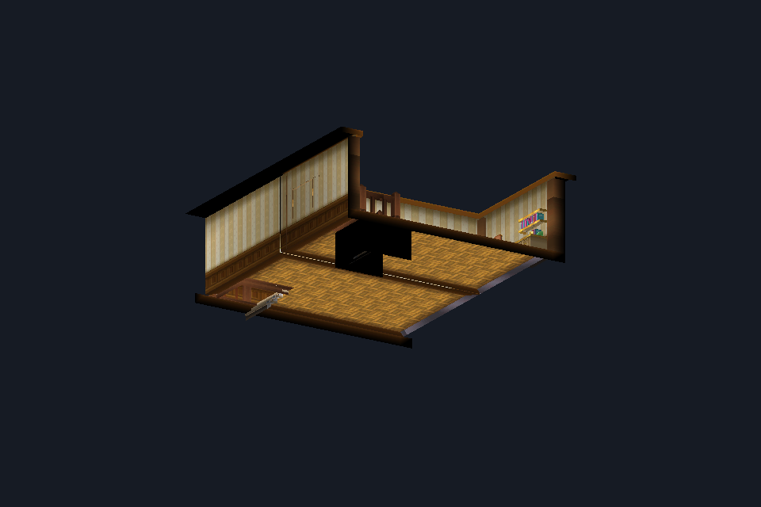

`--combiners` evaluates all six TEV stages with 8-bit integer arithmetic that
follows the pinned Azahar software rasterizer: ten operations, operands, scales,
constants and the delayed combiner buffer. The reader now also decodes vertex
colors, both stored attributes and fixed float24 attributes, so baked shading
appears. Four meshes use fixed colors; for example, the grayscale curtain texture
receives a green tint and the gray shadow texture a brown one.

Unexecuted inputs are declared rather than guessed silently: the vertex color
stands in for the vertex shader's primary output, fragment lighting is white with
a black secondary, projection-mapped units read a white texel, and disabled units
read zero. The viewer measures whether the projected substitute or the secondary
color can change each material's result. For this field neither can: the stage-4
projected term is multiplied by a zero constant. Every chain does multiply by the
lighting color, which makes fragment lighting the main remaining input.

An independent table-driven oracle matched the native evaluator on 80,000 random
evaluations and 36,000 evaluations of the field's twelve chains, and all 2,356
vertex colors match an independent decode. This is equivalence to an emulator's
documented behavior, not a hardware measurement or a game capture. See the
[combiner record](../native/reproduction/bch-combiners/README.txt).

## Directional fragment lighting

```sh
native/build/pokemon_model_viewer --romfs /path/to/romfs \
  --archive a/0/4/1 --entry 165 --section 1 --triangle-list --textured --combiners \
  --texture-archive a/0/1/3 --texture-entry 75 --texture-section 11 \
  --environment-archive a/0/0/3 --environment-entry 137 --environment-section 0 \
  --lighting day   # or night
```

<table>
  <tr>
    <td></td>
    <td></td>
  </tr>
</table>

The field's lights are not in its model or area pack. A scan of the RomFS found
lights and scenes in one place: archive `a/0/0/3` entry 137, a BM pack whose first
section is a BCH environment with 16 lights and a scene of 12 light sets. Every
material's light-set index resolves there (set 1 for the window chip, set 0 for
the rest); the game's binding of this entry to the field is inferred, not traced.

The original code fixes two conventions. The light upload negates the
view-space direction before writing the light-position registers, so the light
vector is `-direction`. Each light color register is the product of the light
and material colors, `((2l+1)(2m+1)) >> 10` per channel. Global ambient is the
material emission, because no ambient light is bound.

The viewer executes directional diffuse and ambient lighting per fragment,
following the pinned emulator's arithmetic, with interpolated, renormalized
normals. Point and spot lights are not executed; their largest possible
contribution is reported, and in this field it is 3/255 in green. Light set 0
enables both the sun and the night light, so `--lighting` chooses between them;
the game's own selection is not traced.

An independent oracle matched all lights, sets, material parameters and 7,068
normal components, all 65,536 color products and 20,970 lighting evaluations.
It also bounded the untraced float16 rounding of the light vector at one level.
See the [lighting record](../native/reproduction/bch-lighting/README.txt).

## Walking the lit room

Add `--walk` to the lighting command to load the terrain grid and collision of
the same GR member. An inspection marker then moves around the lit room: WASD
moves it, and `--steps UDLR...` scripts the moves.

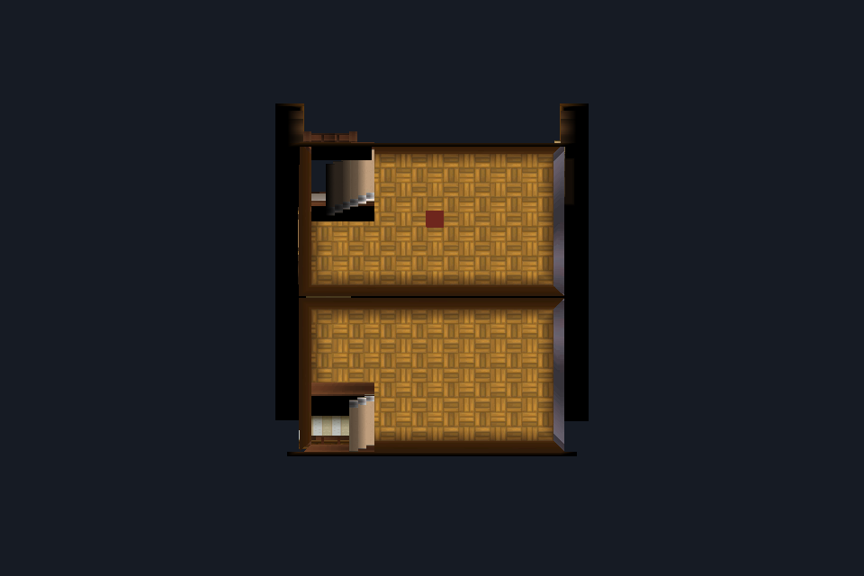

The model, the 40 × 40 terrain grid and the collision share one region-local
frame. An independent check walked the marker to all 52 standard cells, and at
each one the collision height matches a floor surface of the room model. The
marker uses the field inspector's exact-cell policy, not the game's movement
rules. See the [walk record](../native/reproduction/bch-walk/README.txt).

## The player character

```sh
native/build/pokemon_model_viewer --romfs /path/to/romfs \
  --archive a/0/4/1 --entry 165 --section 1 --triangle-list --textured --combiners \
  --texture-archive a/0/1/3 --texture-entry 75 --texture-section 11 \
  --environment-archive a/0/0/3 --environment-entry 137 --environment-section 0 \
  --walk --player-archive a/0/2/1 --player-entry 2 --player-section 0
```

<table>
  <tr>
    <td>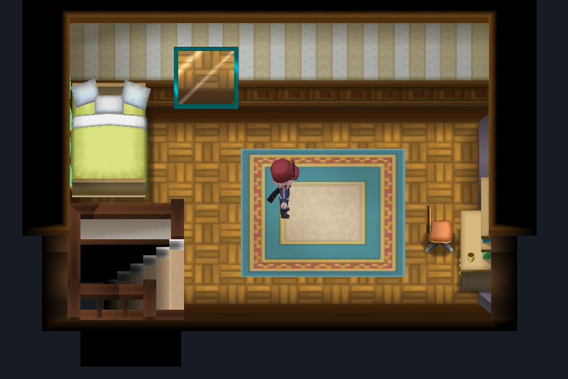</td>
    <td>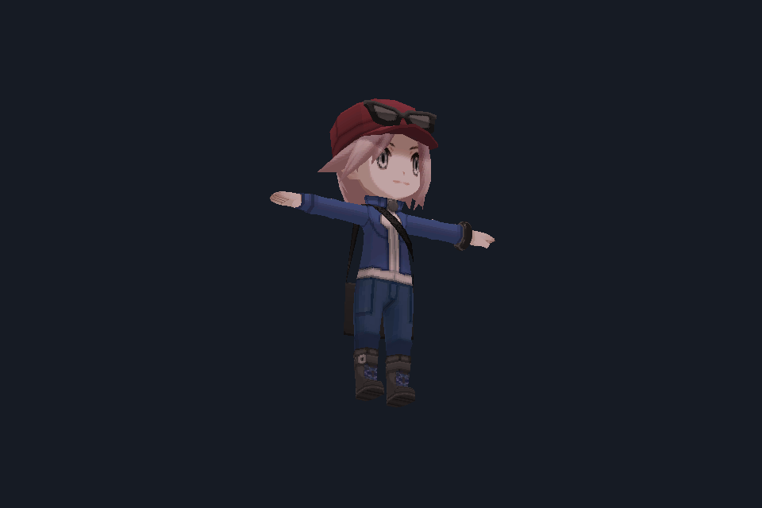</td>
  </tr>
</table>

The marker is now the game's player-character model, `tr0002_00_fi` from the
field character archive `a/0/2/1`. It is a complete model with nine textured
parts. The male player model in the same archive is assembled from outfit parts
at run time and is not supported yet.

The decoder now reads skeletons, per-submesh bone palettes, and bone indices and
weights. The model is posed at rest using the arithmetic of the
pinned vertex-shader translation. Its world transform times its inverse bind
matrix is the identity for all 45 bones, and an independent pose of all 6,099
vertices matches exactly.

The player is lit by the environment's character light set. The rest pose is a
T-pose; the next section animates it.

The walk camera now looks from above. The inspection camera's earlier negative
pitch had put the eye below the floor. See the
[player record](../native/reproduction/bch-player/README.txt).

## Animating the player

```sh
native/build/pokemon_model_viewer --romfs /path/to/romfs \
  --archive a/0/4/1 --entry 165 --section 1 --triangle-list --textured --combiners \
  --texture-archive a/0/1/3 --texture-entry 75 --texture-section 11 \
  --environment-archive a/0/0/3 --environment-entry 137 --environment-section 0 \
  --walk --player-archive a/0/2/1 --player-entry 2 --player-section 0 \
  --motion-section 1 --motion 1 --walk-motion 3
```

<table>
  <tr>
    <td>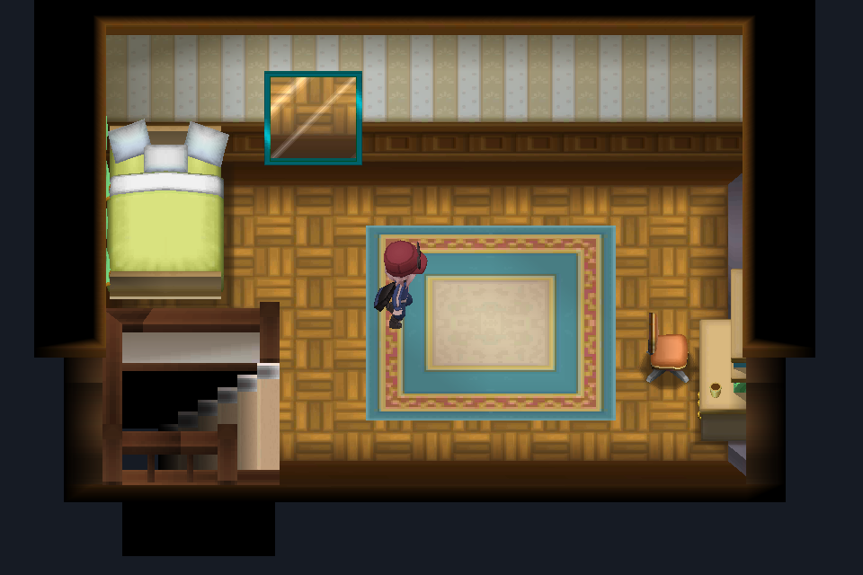</td>
    <td>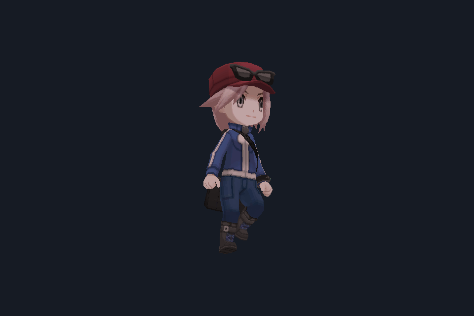</td>
  </tr>
</table>

The 173-item pack beside the player model is a GF1 motion pack: a 42-bone
motion skeleton and 118 motions with 95,232 keys. The decoder follows SPICA's
reading of the format and consumes every motion exactly. Channels are
evaluated as SPICA does, with constant, linear and Hermite keys, and applied to
the model's bones by name. The two feet are stored in world space; they are
converted with SPICA's method, not a solver traced in the game.

The rigid glasses hang from a bone that no motion animates, but its rest
position equals a head locator's. The viewer attaches the glasses to that
locator; this is an inspection rule.

Slot 1 is a standing pose, slot 3 a walk cycle and slot 4 a run. These were
identified by rendering. With `--walk-motion 3`, each step plays one walk cycle
while the player glides to the next cell. An independent decoder and pose match
the native one at every checked frame: all 4,110 channel values are
bit-identical and all 6,099 vertices identical. The game's motion choice,
playback rate and controller are not traced. See the
[motion record](../native/reproduction/bch-motion/README.txt).

## Playing the house

```sh
native/build/pokemon_model_viewer --romfs /path/to/romfs --zone 5
```

<table>
  <tr>
    <td>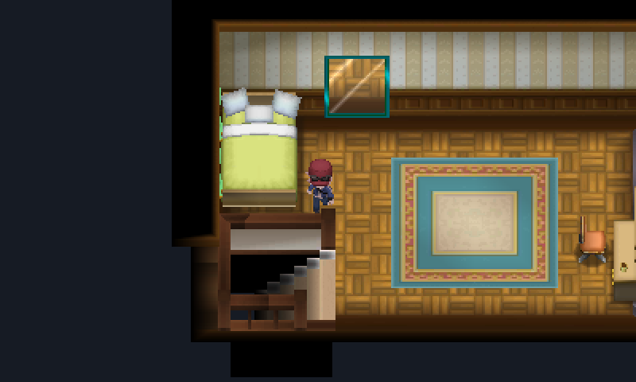</td>
    <td></td>
  </tr>
</table>

`--zone` loads everything from the zone's own data: its area and matrix, the
region's model, terrain and collision, the area's textures, and the zone's
warps and NPCs. The NPC's model comes from the area's NPC registry. The
entity layout follows pk3DS and CTRMap; all 360 zones and 170 registries decode
identically in an independent reader.

The player walks in real time. Held keys keep walking, Shift runs, and each
step plays part of the walk or run cycle while the player glides between cells.
NPCs block their tiles. Space turns the NPC ahead toward the player and reports
its script number; the script engine, and so the dialogue, is not executed yet.

Walking into the bedroom stairs loads zone 4, the floor below, and the stairs
there lead back up. The front door leads outside, into the town described
below. An independent model of the walking rules
predicts the viewer's walks through the house exactly. See the
[zone record](../native/reproduction/bch-zone/README.txt).

## Talking to NPCs

<p align="center">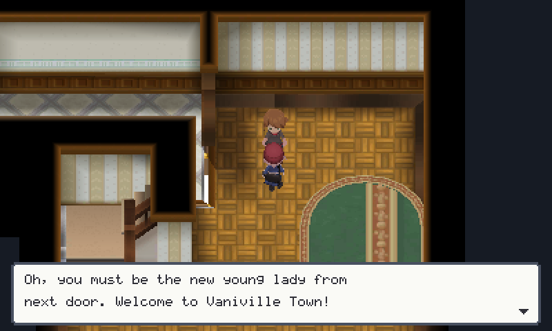</p>

Talking now runs the game's own script. Each zone carries a compiled Pawn 3.3
script; its entry point picks an event by the NPC's script number. The viewer
runs that event in an independently written interpreter and shows the lines of
story text it selects. The text comes from the game's English story-text archive,
which decodes in full: 424 files and 7,607 lines.

The script calls native functions by name hash. Five of them have meanings
inferred from how the scripts use them: show a message, ask whether the player is
female, read a story value, and two "is it finished" waits. Everything else does
nothing, as in a new game. With that, 1,183 of the 2,524 NPCs in the game say
something, and every line they pick exists in their zone's text. A separate
Python decoder and interpreter agree on every one of those runs.

The window and font are drawn by the viewer itself: the game uses the console's
system font, which is not part of the game data. See the
[dialogue record](../native/reproduction/bch-talk/README.txt).

## Vaniville Town

<table>
  <tr>
    <td></td>
    <td></td>
  </tr>
</table>

The front door of the player's house now leads out into Vaniville Town, and
the town's doors lead back in. A town spans several map regions. The viewer
finds the zone's cells in the map matrix's table of zones, loads each region
with its own terrain and collision, and joins their grids into one. NPCs and
warps are stored in world tiles, which the viewer shifts into that grid. The
town's NPCs stand in their places and talk with the game's own lines.

Every region also places props: doors, lamps, fences, and the furniture inside
the houses. The viewer draws them from the area's prop registry and the
building-model archive, at their stored positions and turns. The house rooms
of the earlier records now show their tables, cabinets and plants; without
props (`--no-props`) the earlier captures are reproduced exactly.

The scene is now heavier, so frames are drawn in horizontal bands on several
CPU cores, with the same pixels as a single pass. With this milestone 287 of the game's 360 zones
loaded (68 of them span several regions), and an independent reader
agrees on every region placement, prop, NPC tile and warp tile. Bump maps,
Fresnel terms and a few TV and PC models are not drawn yet. See the
[town record](../native/reproduction/bch-town/README.txt).

## On to Aquacorde Town

<table>
  <tr>
    <td>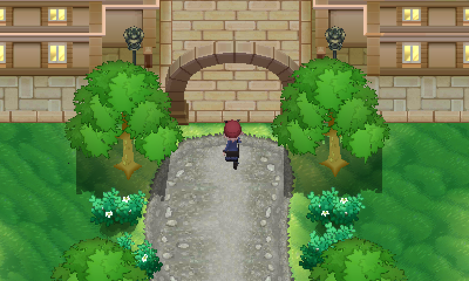</td>
    <td>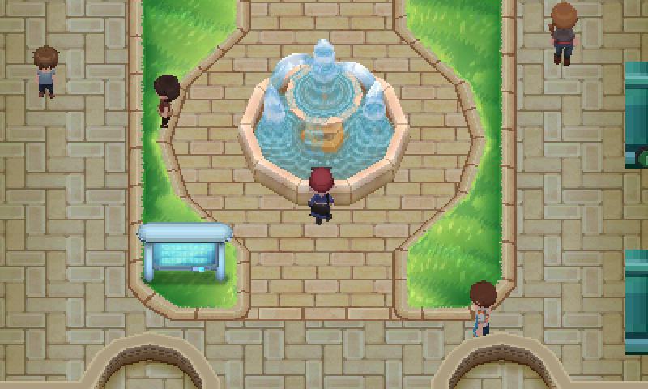</td>
  </tr>
</table>

The path north of Vaniville now leads on. Each map cell belongs to a zone, and
when the player steps into a cell of another zone the viewer switches to it
without a load screen, keeping the player's position: up Route 1 and into
Aquacorde Town, with its fountain and its own townspeople. Every scene also
loads the ring of map cells around the zone, so the next area is already in
view at the edge. Aquacorde's water needed two more kinds of blending,
including blending by the alpha already on screen; the viewer now supports the
3DS blend factors in general. 291 of the 360 zones load, and an independent
walk over the map predicts both crossings. See the
[route record](../native/reproduction/bch-route/README.txt).

<table>
  <tr>
    <td>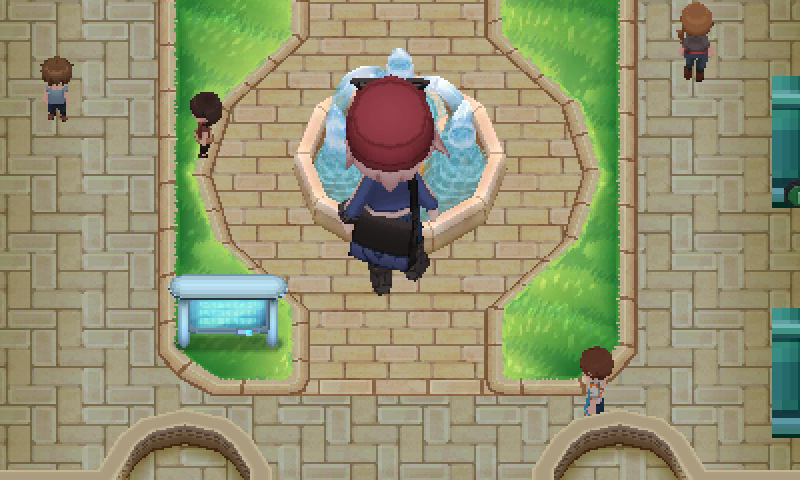</td>
    <td>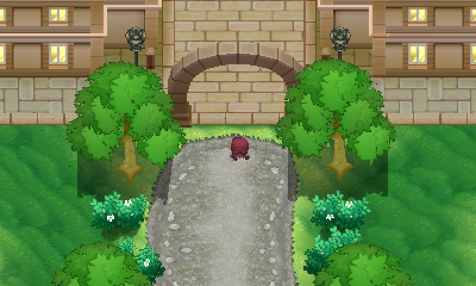</td>
  </tr>
</table>

For fun, `--silly giant` makes the player three times larger, and
`--silly moonwalk` makes the player walk facing backwards with the walk cycle
reversed. Neither is game behaviour, and they change nothing else.

## A first wild battle

<table>
  <tr>
    <td>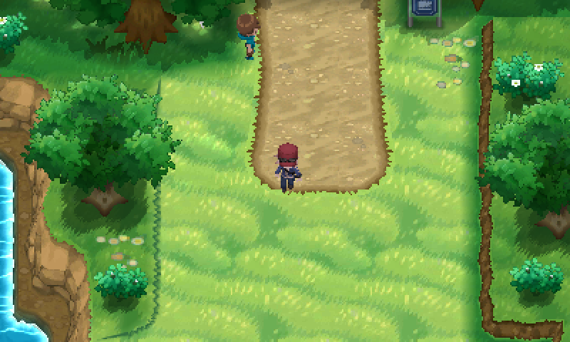</td>
    <td>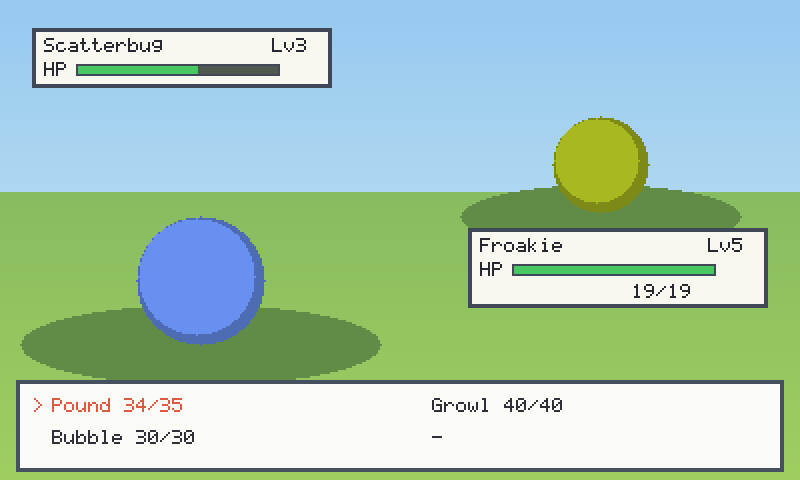</td>
  </tr>
</table>

Route 2 has tall grass, and stepping into it can now start a wild battle. The
wild Pokémon comes from the zone's own encounter table, at the levels it
lists: on Route 2 that is Bunnelby, Zigzagoon, Fletchling, Pidgey, Scatterbug
or Weedle. The player's partner is Froakie by default. Both use the game's
base stats, types, moves and learnsets, the game's type chart from its battle
module, and the game's nature table. HP and stats are computed by the
reconstructed routines of the [stats milestone](../reconstructed/pokemon_stats/README.md),
which run inside the viewer for the first time.

The battle itself is one-on-one: Fight with up to four moves, or Run. Damage,
critical hits, accuracy, stat stages, turn order and escaping follow the
published Generation VI formulas, until they can be traced in the game's
battle module. Status moves change stats as their move data says; other
effects, items, catching and experience are not there yet. The battle
screen is the viewer's own, with coloured placeholders where the Pokémon's
models will go. After the battle the player walks on with the partner's HP
kept.

Meshes without texture coordinates now decode too, which brings 328 of the
360 zones into the viewer. An independent check agrees on all the battle data, on 9,576 stat
calculations and 20,000 damage calculations, and predicts every message of
the recorded battle. See the
[battle record](../native/reproduction/bch-battle/README.txt).

## Catching and levelling up

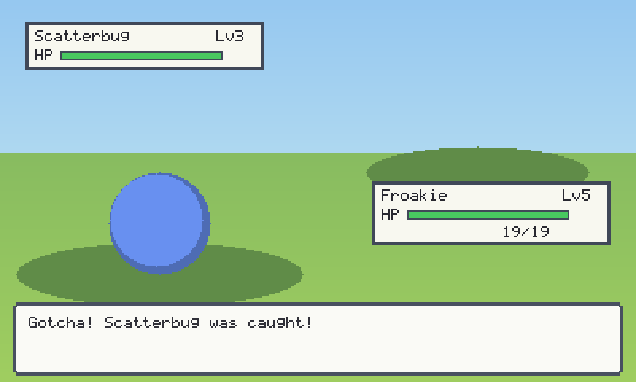

Battles now pay out. Winning gives the partner experience (the defeated
Pokémon's base experience times its level, over seven), counted against the
game's own growth tables: eight tables of 101 totals, one per growth group.
The level that follows is worked out by the reconstructed
level-from-experience routine of the stats milestone, and on a level-up the
partner learns whatever its learnset lists at the new level, if a move slot
is free.

The command menu is now FIGHT, BALL and RUN. BALL throws a Poké Ball (ten to
start with, or `--balls N`): the catch chance uses the Pokémon's catch rate
and remaining HP with the published Generation VI formula and four shake
checks, and a failed throw costs the turn. A caught Pokémon joins the party,
up to six. The experience and catch formulas are published ones until they
can be traced in the game's battle module; items, other balls, switching,
evolution and PC boxes are not there yet.

An independent check agrees with all eight growth tables and with the
published experience formulas at every level, and on 266,514 level,
experience and catch calculations. See the
[catch record](../native/reproduction/bch-catch/README.txt).

## The Pokémon themselves


With the 1 GB Pokémon model archive (`a/0/0/7`) in the RomFS, the coloured
circles give way to the Pokémon's own 3D models with the game's textures,
lit like the field. The archive starts with an index from species to model;
each of its 981 models has eight files, of which the viewer reads the model
and its textures. Two small decoder extensions were needed: model files
reserve memory the game fills at load time, and some materials use
environment maps, which are left white for now as projected textures are.

The models stand in their rest pose: the battle animations sit in the same
archive but are not decoded yet, so arms stick out and Scatterbug lies on its
side. Each species shows its first model (no forms, genders or shinies), and
the camera and scale are the viewer's own. An independent parser agrees with
the native decoder on all 977 non-empty models, and on every vertex of the
rest pose for 57 of them. See the
[battle model record](../native/reproduction/bch-pokemon/README.txt).
